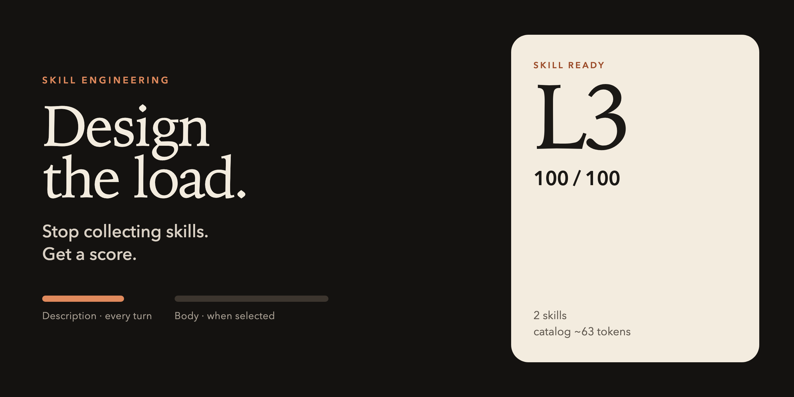

# 技能工程

<p align="center">
  
</p>

> **别再收集技能。设计加载。拿到分数。**

每个技能的 `description` 会在每一轮开始前被加载。正文只在选中该技能时才加载。写得很长的描述不是文档，是每次请求都要付的税。

```bash
git clone https://github.com/cobusgreyling/skill-engineering.git
cd skill-engineering
node bin/skill.mjs doctor examples/messy
```

给已有项目打分：

```bash
node /path/to/skill-engineering/bin/skill.mjs doctor /path/to/your/repo
node /path/to/skill-engineering/bin/skill.mjs init /path/to/your/repo
```

`doctor` 读取这些目录里的 `SKILL.md`：`.grok/skills`、`.claude/skills`、`.cursor/skills`、`.agents/skills`、`.codex/skills`、`skills/`。`--user` 会再加上用户主目录里的同名文件夹。L2 及以上退出码为 0，CI 可以用 `--min L3`。

本仓库给自己打分是 L3：

```bash
node bin/skill.mjs doctor .
```

```
Skill Ready  L3  100/100
1 skill  ·  catalog ~36 tokens of 4000
```

## 一个不及格的目录

`examples/messy` 里有三段问题：描述写成了短文、两个技能同名、描述里没有触发条件。

```
Skill Ready  L1  40/100
3 skills  ·  catalog ~179 tokens of 4000
```

完整输出见英文首页。阻塞项是 `missing-trigger`、`essay-description` 和 `duplicate-name`。不及格时，`doctor` 会印出一条合格描述的形状：一句话写清任务，再用 “Use when the user asks to …” 写清触发条件，并控制在 280 个字符以内。

## 一个及格的目录

`examples/tight` 是 L3，100/100。合格的描述同时写出任务和触发条件：

```yaml
description: Review a code diff for scope, tests, and regressions. Use when the user asks for a review of a pull request or a local diff.
```

## 等级

| 等级 | 含义 |
|------|------|
| L0 | 扫描路径上没有 `SKILL.md`。 |
| L1 | 有阻塞项。技能目录的加载是错的。 |
| L2 | 没有阻塞项，仍有警告。 |
| L3 | 没有阻塞项，也没有警告。 |

检查项和阈值：[docs/checks.md](docs/checks.md)。等级如何判定：[docs/levels.md](docs/levels.md)。

`init` 会写入 `.grok/skills/skill-budget.yaml`。目录里还没有任何技能时，再写一个能打到 L3 的示例技能。已有的预算文件和技能不会被覆盖。

Token 按 `ceil(字符数 / 4)` 估算，所以分数不跟着分词器变。

MIT。Node 18 或更高。没有依赖。

[English](README.md)
